<!-- ──────────────────────────────────────────────────────────────
  Animaciones: los SVG de /assets usan CSS @keyframes + SMIL, que
  GitHub sí reproduce dentro de . Sin JavaScript (GitHub lo bloquea).
─────────────────────────────────────────────────────────────── -->

 

 

> **Construyo productos que conectan ingeniería de software, automatización e inteligencia artificial.**
> De una arquitectura sólida a una experiencia que se siente simple.

 

## ⚡ AI ENGINE / agentes e IA aplicada

  
    
  
  
  
  
  
  
  

 

## 🧬 TECH DNA / stack

  

 

<table>
  <tr>
    <td width="26%"><b>01 · Lenguajes</b></td>
    <td></td>
  </tr>
  <tr>
    <td><b>02 · Frontend + Mobile</b></td>
    <td>
       
      <code>React Native (bare)</code> · <code>Zustand</code> · <code>React Query</code>
    </td>
  </tr>
  <tr>
    <td><b>03 · Backend + Datos</b></td>
    <td>
       
      <code>REST</code> · <code>GraphQL</code> · <code>Sidekiq</code> · <code>JWT</code> · <code>Firestore</code> · <code>Cloud Functions</code>
    </td>
  </tr>
  <tr>
    <td><b>04 · DevOps + Tools</b></td>
    <td></td>
  </tr>
</table>

 

## 🔌 CONNECTIONS / integraciones

 

## 📡 GITHUB TELEMETRY

  
  
   
  
   
  

 

<!-- Serpiente animada: la genera .github/workflows/snake.yml en la rama "output" -->

  <picture>
    <source media="(prefers-color-scheme: dark)" srcset="https://raw.githubusercontent.com/angelivan44/angelivan44/output/snake-dark.svg" />
    <source media="(prefers-color-scheme: light)" srcset="https://raw.githubusercontent.com/angelivan44/angelivan44/output/snake-light.svg" />
    
  </picture>

  
  © Ángel Iván Huayas Izquierdo

